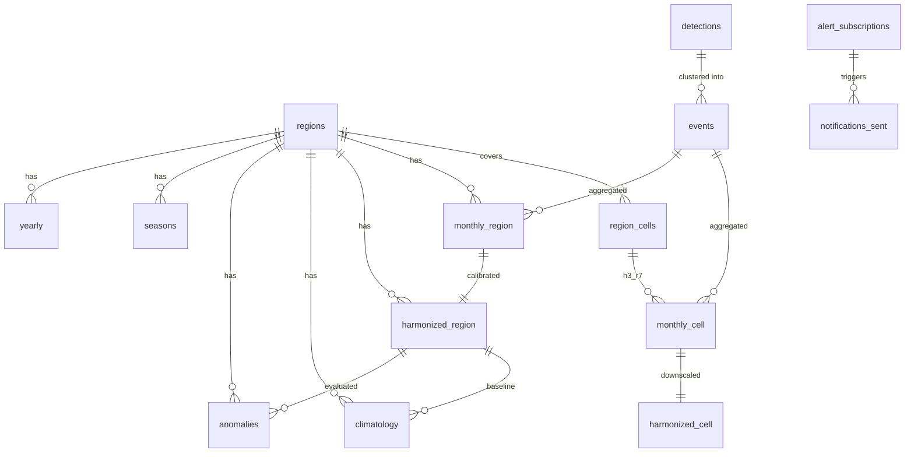

# Data schema (Parquet tables, SQLite app state)

Single source of truth for every dataset. Update it in the same commit as any change. Conventions: timestamps UTC; `h3_*` columns are `UINT64` in Parquet (hex strings in JSON); `year` INT16, `month` INT8 (1-12); `region_id` string; counts are `FLOAT64` once harmonized (non-integer) and `INT64` when raw; all files ZSTD-compressed Parquet.

## 1. Lineage and relationships

Pipeline order: raw CSV -> `detections` -> `events` -> `monthly_cell`, `monthly_region` -> `harmonized_region`, `harmonized_cell` -> `climatology`, `anomalies`, `seasons`, `yearly` -> shipped to `data/processed/<version>/` with `manifest.json`.

## 2. Reference data (`data/reference/`, committed)

### regions.geojson (and regions.parquet without geometry)
`region_id` (e.g. `BGD`, `BGD-ADM1-chattogram`, `BGD-ADM2-rangamati`, `PRESET-CHT`), `name`, `level` (`country`|`adm1`|`adm2`|`preset`), `parent_id`, `bbox` [w,s,e,n], `aliases` [string] (for the assistant), `geometry` (simplified polygon). Source and license recorded in `data/reference/SOURCES.md`.

### region_cells.parquet
`region_id`, `h3_r7` (UINT64). Each r7 cell belongs to exactly one district (by cell centroid); `PRESET-CHT` and parents are derived by union. Invariant: every `h3_r7` in `monthly_cell` that lies inside Bangladesh appears once at district level.

### guidance.json (P1)
List of `{ id, stage (pre_season|in_season|post_season|extreme|off_season), audience, text, source_title, source_url, verified (bool) }`.

## 3. Pipeline tables (`data/interim/` and `data/processed/<version>/`)

### detections (normalized pixels)
| Column | Type | Notes |
| --- | --- | --- |
| detection_id | INT64 | sequential, deterministic per file order |
| sensor | STRING | `MODIS_TERRA`, `MODIS_AQUA`, `VIIRS_SNPP`, `VIIRS_NOAA20`, `VIIRS_NOAA21` |
| sensor_family | STRING | `MODIS` or `VIIRS` |
| lat, lon | FLOAT64 | WGS84 |
| acq_ts | TIMESTAMP (UTC) | from `acq_date` + `acq_time` (HHMM, leading zeros dropped: `"52"` is 00:52) |
| daynight | STRING | `D` or `N` |
| confidence_raw | STRING | original value |
| confidence_class | STRING | `nominal` or `high` after filtering (`low` dropped) |
| frp_mw | FLOAT64 | fire radiative power, nullable |
| scan, track | FLOAT64 | pixel size info |
| version | STRING | product version field |
| source_file | STRING | file name |

Dedup key: `(sensor, lat, lon, acq_ts)`; duplicates dropped.

### events
`event_id` INT64, `sensor_family`, `n_pixels` INT32, `start_ts`, `end_ts`, `lat`, `lon` (mean of pixels), `frp_sum`, `frp_max`, `h3_r5`, `h3_r6`, `h3_r7`, `year`, `month` (UTC month of `start_ts`), `district_id` (nullable if outside Bangladesh polygon; such events are dropped from monthly tables but counted in the manifest).

### monthly_cell
`h3_r7`, `h3_r6`, `h3_r5`, `district_id`, `sensor_family`, `year`, `month`, `event_count` INT32, `frp_sum` FLOAT64. Sparse (only non-zero rows). Unique `(h3_r7, sensor_family, year, month)`.

### monthly_region
`region_id` (district level), `sensor_family`, `year`, `month`, `event_count`, `frp_sum`. Dense: one row for every district x family x month in that family's coverage (zeros included). Unique `(region_id, sensor_family, year, month)`. Coverage: MODIS from 2000-11, VIIRS from 2012-02 (first complete month; VERIFY from data).

### harmonized_region
`region_id` (country, division, district), `year`, `month`, `raw_modis`, `raw_viirs` (nullable before 2012-02), `harmonized` FLOAT64 (MODIS-equivalent events), `source_used` (`modis_raw`|`viirs_calibrated`), `method` (`quantile_map`|`ratio`|`none`), `calibration_unit_id`, `in_overlap` BOOL, and optional `provisional` BOOL (set by D08 for NRT months `>= provisional_from`). Division and country rows are the sum of their districts. Unique `(region_id, year, month)`.

### calibration_report
`calibration_unit_id`, `method_chosen`, `cv_rmse_qm`, `cv_rmse_ratio`, `cv_mae_qm`, `cv_mae_ratio`, `cv_bias_qm`, `cv_bias_ratio`, `spearman_qm`, `n_overlap_months`, `fallback_to_parent` BOOL, plus the fitted transfer-function knots as JSON (`knots_v`, `knots_m`) per month-group.

### harmonized_cell
`h3_r7`, `h3_r6`, `h3_r5`, `district_id`, `year`, `month`, `harmonized` FLOAT64, `source_used`. Invariant: sum over cells of a district-month equals the district `harmonized` (tolerance 1e-6), unless the district-month `raw_viirs` is 0 and the source is `viirs_calibrated` (then all cells are 0 and the district harmonized may be positive; this gap is recorded in the manifest as `unallocated_harmonized`).

### climatology
`region_id`, `month`, `n_years`, `mean`, `p50`, `p90`, `p95`, `baseline_year_min`, `baseline_year_max`.

### anomalies
`region_id`, `year`, `month`, `value`, `percentile_rank` (share of baseline values <= value), `class` (`normal`|`elevated`|`extreme`|`insufficient_data`), and optional `provisional` BOOL (D08). Baseline excludes the evaluated year and excludes provisional rows; current partial NRT month scales baseline by `days_elapsed / days_in_month`.

### seasons
`region_id`, `start_month`, `peak_month`, `end_month`, `share_of_annual` (0-1), `window_length`.

### yearly
`region_id`, `year`, `harmonized_total`, `frp_sum`, `rank` (1 = most), `vs_mean_pct` (percent vs mean of other years), `peak_month`.

### manifest.json
`data_version`, `created_at`, `git_commit`, `as_of_date` (last data date), `provisional_from` (first date of NRT-only data, nullable), `provisional_note` (nullable note on NOAA-20 cross-sensor/unadjusted status and MTD baseline scaling), `parameters` (copy of config), `sources` (file names, row counts, checksums), `counts` (detections kept/dropped by reason, events, noise points, events outside Bangladesh), `unallocated_harmonized`, `pipeline_version`.

## 4. App state (SQLite `app.db`, P1)

### alert_subscriptions
`id` INTEGER PK, `email` TEXT, `area_id` TEXT, `rule` TEXT (`season_approaching`|`above_normal`|`both`), `lead_days` INTEGER default 14, `confirmed` BOOL, `unsubscribe_token` TEXT unique, `created_at`.

### notifications_sent
`id` PK, `subscription_id` FK, `rule`, `period` TEXT (e.g. `2027-03`), `sent_at`, unique `(subscription_id, rule, period)` so a condition notifies once per period.

### ask_log
`id` PK, `created_at`, `question` TEXT (max 500 chars), `mode` (`live`|`replay`), `tool_calls` JSON, `answer` TEXT, `data_version`. No IP addresses stored.

## 5. Invariants (tests must enforce)

1. All timestamps UTC; `month` equals the UTC month of `start_ts`.
2. No detection with `confidence_class` low survives `detections`.
3. Every event has `n_pixels >= min_pts` and one sensor family; no event mixes MODIS and VIIRS pixels.
4. `sum(event_count)` in `monthly_region` equals the number of events assigned to districts (per family).
5. District `harmonized` sums to division and country values.
6. Cell downscaling conserves totals (see `harmonized_cell`).
7. Re-running the pipeline with the same raw files and config yields identical Parquet content (determinism) and the same `data_version` content hash.
8. Every API number is traceable to a table row of the active `data_version`.
